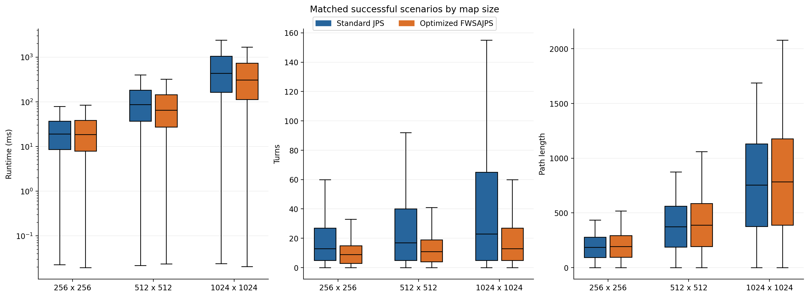
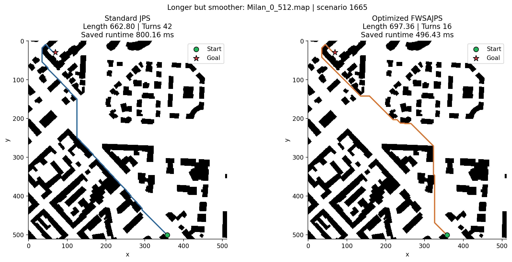

# Enhanced 2D Path Planning Optimization

Python research code for benchmarking A*, Jump Point Search (JPS), and smoothness-aware JPS variants on MovingAI grid maps. The project includes optimized Fast Weighted SA-JPS, configurable turning penalties, parallel benchmarks, resumable checkpoints, sensitivity experiments, and report generation.

## Work overview

This work investigates whether grid paths can be found faster and with fewer direction changes while accepting a controlled preference for smoothness over shortest distance. The main evaluated method is **Optimized Fast Weighted Smoothness-Aware JPS** (Optimized FWSAJPS; labeled `Optimized Fast Weighted SA-JPS` in the code).

The implementation combines:

- **Heading-aware search:** states retain both grid position and incoming direction, allowing the search cost to include turning penalties.
- **Weighted search:** a weighted distance heuristic biases expansion toward the goal.
- **Faster jump scanning:** iterative JPS rays, caching within each query, and a fixed direction-to-direction turn-cost lookup. There is no offline map preprocessing or cache shared between queries in this optimized jump routine.
- **Reproducible evaluation:** configurable experiments, parallel workers, SQLite checkpoints, matched-scenario comparisons, CSV tables, and report figures.

The framework contains several search variants, but the saved `street_all` benchmark below evaluates **Standard JPS versus Optimized FWSAJPS only**. It is not an A* comparison or an isolated ablation of each optimization.

## Search equations

For a path $P$, let $L(P)$ be geometric grid length, $S(P)$ accumulated turning severity, and $T(P)$ the number of heading changes:

$$
L(P)=\sum_i \ell_i,\qquad
S(P)=\sum_i \frac{|\Delta\theta_i|}{45^\circ},\qquad
T(P)=\sum_i \mathbf{1}[\Delta\theta_i\ne 0].
$$

Cardinal steps cost $1$ and diagonal steps cost $\sqrt{2}$. Each heading change is the smaller angle between successive directions; the initial heading has no turn penalty. The optimized search accumulates:

$$
g(P)=L(P)+\lambda S(P)+\beta T(P).
$$

Its primary queue priority is:

$$
f(n)=g(n)+w\,h_{\mathrm{octile}}(n),\qquad
h_{\mathrm{octile}}=\max(d_x,d_y)+(\sqrt{2}-1)\min(d_x,d_y),
$$

where $d_x$ and $d_y$ are absolute coordinate differences to the goal. The saved experiment uses **$\lambda=0.35$, $\beta=5.0$, and $w=1.15$**. Standard JPS uses distance cost and $w=1.0$, with smooth tie-breaking disabled. In the optimized objective, a 90-degree heading change adds $0.35\times2+5=5.7$ cost units beyond distance.

These are the implemented search costs, not a proof of global optimality: standard JPS pruning does not establish optimality for the heading-dependent objective, and the weighted heuristic can trade path length for speed.

## Saved benchmark

The [saved report](results_new_ablation/street/street_all/reports/20261014_095139_711340/report.html) was generated on **14 October 2026** from the street checkpoint. Its [manifest](results_new_ablation/street/street_all/reports/20261014_095139_711340/manifest.json) records the configuration and matched coverage:

| Property | Saved evaluation |
| --- | --- |
| Dataset | MovingAI street maps and scenarios |
| Map files | 90 |
| Grid sizes | 256 × 256, 512 × 512, 1024 × 1024 |
| Matched scenarios | 197,490 |
| Scenarios by size | 28,020 / 56,270 / 113,200, respectively |
| Successful pairs | 197,490 (100% for both algorithms) |
| Unmatched saved runs / invalid metadata exclusions | 0 / 0 |

Results are paired by scenario. The report provides pooled summaries, breakdowns by map size and reference-path length, and statistical comparisons. Its primary inference uses within-map median paired differences with an exact sign test and Holm correction; scenario-level Wilcoxon tests are exploratory. Maps from the same source city may be dependent, so the repository also includes [city-grouped reports](results_new_ablation/street/street_all/reports_city/).

## Key results

Values below are **median [25th percentile, 75th percentile]** across matched scenarios, taken from the [overall table](results_new_ablation/street/street_all/reports/20261014_095139_711340/table_1_overall.csv).

| Metric | Standard JPS | Optimized FWSAJPS |
| --- | ---: | ---: |
| Runtime (ms) | 175.18 [48.78, 586.51] | 128.89 [38.17, 424.78] |
| Path length (grid units) | 470.86 [218.88, 851.11] | 488.96 [225.60, 888.25] |
| Turns | 19 [5, 49] | 11 [5, 23] |
| Total turning angle (degrees) | 855 [225, 2,205] | 495 [225, 1,035] |
| Waypoints | 21 [7, 51] | 13 [7, 25] |
| Expanded nodes | 84 [19, 286] | 86 [21, 323] |

Comparing these overall medians gives **26.42% lower runtime**, **42.11% fewer turns**, and **3.85% longer paths**. These percentages are changes between distribution medians, not median improvements per scenario. The [paired change table](results_new_ablation/street/street_all/reports/20261014_095139_711340/relative_changes.csv) instead gives a median per-scenario runtime change of **−32.48%**; the median per-scenario path-length and turn-count changes are both **0%**. Percentage calculations exclude nonpositive baseline values.

The [win/tie/loss counts](results_new_ablation/street/street_all/reports/20261014_095139_711340/win_tie_loss.csv) make the trade-off explicit:

| Optimized method relative to JPS | Better | Tied | Worse |
| --- | ---: | ---: | ---: |
| Runtime | 146,839 | 1,890 | 48,761 |
| Path length | 0 | 104,487 | 93,003 |
| Turns | 94,838 | 100,736 | 1,916 |

Runtime ties use a descriptive ±1% tolerance; path-length ties use an absolute tolerance of $10^{-7}$; turn ties require equality. The optimized method is not faster on every query, and its pooled expanded-node median is slightly higher. The recorded improvement therefore should not be described as uniformly reducing search effort. These are saved implementation timings, not a hardware-independent speed guarantee.

## Selected plots

**Performance by map size.** Runtime gains are more pronounced on the larger maps; the plots also show the reduction in turns and the path-length trade-off.



**A longer but smoother route.** On `Milan_0_512.map`, scenario 1665, the optimized route has 16 turns versus 42, with length 697.36 versus 662.80. Paths were reconstructed and checked against saved metrics; the runtime annotations are original measurements.



Further figures cover [paired runtimes](results_new_ablation/street/street_all/reports/20261014_095139_711340/figure_5_runtime_scatter.png), [win/tie/loss proportions](results_new_ablation/street/street_all/reports/20261014_095139_711340/figure_6_win_tie_loss.png), and [length versus turns](results_new_ablation/street/street_all/reports/20261014_095139_711340/figure_3_tradeoff.png). The [report directory](results_new_ablation/street/street_all/reports/20261014_095139_711340/) contains PNG/PDF figures and the supporting CSV tables; download `report.html` with its companion files to view the full report locally.

## Project layout

| Path | Contents |
| --- | --- |
| `server/Astar_JPS_SA_JPS_config_profiles_ready.py` | Main benchmark entry point and search implementations |
| `server/benchmark_config.py` | Dataset definitions, experiment profiles, and parameter settings |
| `server/parallel_benchmark.py` | Parallel benchmark support |
| `server/exp_config.json` | Comparison of standard JPS and original/optimized Fast Weighted SA-JPS |
| `server/exp_smoothness.json` | Comparison with an additional per-turn penalty |
| `server/create_report.py` | Matched-scenario reports from SQLite checkpoints |
| `server/create_report_city.py` | Reports with source-city grouping support |
| `server/presentation_plots.py` | Presentation figures and path illustrations |
| `server/tests/` | Unit tests and benchmark validation utilities |
| `results_new_ablation/` | Existing experiment outputs, logs, and checkpoints |

`server/run_benchmark.py` only prints a selected configuration; use the main benchmark entry point shown below to run experiments.

## Installation

Python 3.10 is specified by the supplied Conda environment.

```bash
git clone https://github.com/Hammoudmsh/Path_planning_2d_optimization_enhanced.git
cd Path_planning_2d_optimization_enhanced
python -m venv .venv
```

Activate the environment:

```powershell
# Windows PowerShell
.\.venv\Scripts\Activate.ps1
```

```bash
# Linux / macOS
source .venv/bin/activate
```

Install dependencies:

```bash
python -m pip install -r server/requirements.txt
```

Alternatively, from `server/`, run `conda env create -f environment.yml` and `conda activate astar_jps`.

Large result CSV, SQLite checkpoint, and pickle files use Git LFS. Install Git LFS and run `git lfs install` before cloning to retrieve these artifacts automatically, or run `git lfs pull` after cloning. They are not required to start a new benchmark.

## Datasets

Datasets are not included in this repository. Download the map and scenario archives specified in `DATASETS` in `server/benchmark_config.py` and extract them into:

```text
datasets/
  street/
    maps/        # .map files
    scenarios/   # .scen files
```

Use the same structure for other supported dataset names: `dao`, `wc3maps512`, `bg512`, `bgmaps`, `sc1`, `maze`, and `random`. Keep map filenames consistent with their scenario files.

Profiles with `download_data: true` can download the configured archives. The comparison, street, test, and sensitivity profiles disable downloads and expect local datasets. Consult the dataset provider's attribution and usage terms when using or redistributing benchmark data.

## Run a benchmark

To run all street maps and scenarios with 16 workers and then generate the report, first prepare the street dataset as described above. From the repository root:

```bash
cd server
python Astar_JPS_SA_JPS_config_profiles_ready.py street street_all --workers 16
python create_report.py
```

Wait for the benchmark to finish successfully before running `create_report.py`. The report script uses the default street checkpoint under `results_new_ablation/street/street_all/cache/` and creates a new report output directory automatically.

Return to the repository root with `cd ..` before using the examples below.

Run these commands from the repository root. Inspect a small experiment without running searches:

```bash
python server/Astar_JPS_SA_JPS_config_profiles_ready.py street test --dry-run
```

After preparing the dataset, run the small comparison:

```bash
python server/Astar_JPS_SA_JPS_config_profiles_ready.py street test
```

Run 50 maps with 20 scenarios per map, or all street maps and scenarios:

```bash
python server/Astar_JPS_SA_JPS_config_profiles_ready.py street street_50x20 --workers 4
python server/Astar_JPS_SA_JPS_config_profiles_ready.py street street_all --workers 4
```

The `street_50x20` profile compares standard JPS with original and optimized Fast Weighted SA-JPS. The `street_all` profile compares standard JPS with optimized Fast Weighted SA-JPS using an additional per-turn penalty.

Override the optimized algorithm's angle penalty (`--lambda`), per-turn penalty (`--beta`), and heuristic multiplier (`--w`):

```bash
python server/Astar_JPS_SA_JPS_config_profiles_ready.py street test --lambda 0.35 --beta 5.0 --w 1.15
```

Use `--map-size 1024` to select square 1024-by-1024 maps and `--map-limit 2` to limit a run. Use `--help` for all command-line options.

JSON experiment configurations are also supported:

```bash
python server/Astar_JPS_SA_JPS_config_profiles_ready.py street full --config-json server/exp_smoothness.json --dry-run
```

Remove `--dry-run` to execute the configured experiment.

## Sensitivity studies and outputs

The `sensitivity_test`, `sensitivity`, and `sensitivity_all` profiles vary one optimized search coefficient at a time. The small test uses two maps and one scenario per map:

```bash
python server/Astar_JPS_SA_JPS_config_profiles_ready.py street sensitivity_test
```

Default outputs are written under `results_new_ablation/<dataset>/<profile>/`. Parameter overrides or JSON configurations may change the output directory. Outputs depend on the profile and include per-run metrics, summaries, figures, plotting data, logs, and resumable checkpoints. Benchmark caching and resume behavior are controlled in `benchmark_config.py`.

## Generate reports

The report scripts default to the included street benchmark checkpoint. After retrieving large artifacts through Git LFS:

```bash
python server/create_report.py --output reports/street
python server/create_report_city.py --output reports/street_city
```

Use a new output directory for each report. Supply `--checkpoint PATH` for another SQLite checkpoint, `--maps-dir datasets/street/maps` for path illustrations, and `--export-pairs` to export scenario-level data. The city report accepts `--city-groups PATH` for a JSON mapping of map filenames to source-city groups.

## Tests

```bash
python -m unittest discover -s server/tests -p "test_*.py"
```

For cluster execution, `server/run_job.slurm` provides a Slurm template. Adjust its partition, resources, and Conda activation path for your system; create the `logs/` directory before submitting from `server/`.

## Research interpretation

Smoothness-aware and weighted variants are experimental. Heading-dependent turn penalties change the search objective, and weighted heuristics can trade path quality for speed. Evaluate runtime, path length, turning metrics, and search effort together; do not assume every variant retains standard JPS distance-optimality.

## Excluded local content

The repository ignores `datasets/`, `New folder/`, `exp.txt`, Python bytecode caches, the two specified street result ZIP archives, and `Astar_JPS_SA_JPS_dataset_suffix_plot_data_mean_median_std.ipynb`. The exported Python benchmark remains included.
